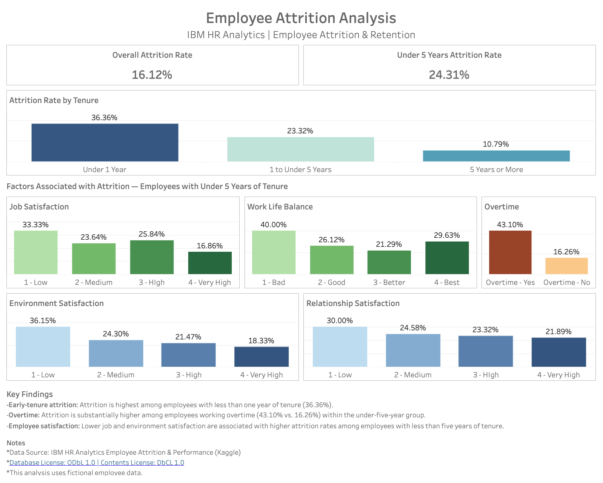

# hr-attrition-analysis

## Project Overview

This project is using fictional employee data from Kaggle.

After presenting the overall employee attrition rate, I analyzed whether work environment satisfaction, job satisfaction, relationship satisfaction, work-life balance, and overtime differed between employees who left and those who stayed, focusing on employees with less than five years of tenure.


## Business Question

How do attrition rates vary by work environment satisfaction, job satisfaction, relationship satisfaction, work-life balance, and overtime among employees with less than five years of tenure?　

For detailed findings, see [Business Insights](reports/findings_and_recommendations.md).


## Key Metrics

- Overall Attrition Rate
- Under 1 Year Attrition Rate
- 1 to Under 5 Years Attrition Rate
- 5 Years or More Attrition Rate
- Under 5 Years Attrition Rate

KPI definitions and calculation methods are documented and validated in the [KPI and the Validation](reports/kpi_validation.csv).


## Tools Used

- Tableau Public — Data visualization and dashboard publishing
- CSV — Exported query results used as dashboard data sources
- GitHub — Version control and portfolio publication

## Dataset

- **Dataset:** [IBM HR Analytics Employee Attrition & Performance](https://www.kaggle.com/datasets/pavansubhasht/ibm-hr-analytics-attrition-dataset)
- **Source:** [Kaggle](https://www.kaggle.com/datasets/pavansubhasht/ibm-hr-analytics-attrition-dataset)
- **License:** The dataset and its contents remain subject to their respective license terms.
    - Database: [Open Database License (ODbL) 1.0](https://opendatacommons.org/licenses/odbl/1-0/)
    - Contents: [Database Contents License (DbCL) 1.0](https://opendatacommons.org/licenses/dbcl/1-0/)

The dataset and its contents remain subject to their respective license terms.

For additional information, see [Data Documentation](data/README.md) and [Data Quality Notes](reports/data_quality_report.md).

## Dashboard

View [Employee Attrition Dashboard on Tableau Public](https://public.tableau.com:9443/views/EmployeeAttritionAnalysisIBMHRAnalytics/Dashboard?:language=en-GB&:sid=&:redirect=auth&:display_count=n&:origin=viz_share_link)


### Dashboard Preview




## Key Insights

- 1. Overtime is strongly associated with higher attrition rates.
- 2. Lower satisfaction ratings are generally associated with higher attrition rates.
- 3. Work-life balance shows a non-linear relationship with attrition.

For detailed findings and limitations, see [Business Insights](reports/findings_and_recommendations.md).

## Recommendations

- Investigate overtime patterns. Examine workload, overtime frequency, and potential differences across job roles to better understand the observed association with attrition.
- Prioritize employee satisfaction assessments. Review feedback from employees with lower job and environment satisfaction ratings to identify potential areas for improvement.
- Investigate work-life balance differences. Review group sizes and additional employee characteristics before drawing conclusions about the non-linear pattern.

For supporting evidence and recommendations, see [Business Insights](reports/findings_and_recommendations.md).

## Repository Structure

```text
hr-attrition-analysis/
├── data/
│   └── README.md
├── references/
│   └── data_dictionary.csv
├── reports/
│   ├── figures/
│   │   └── dashboard.png
│   ├── data_quality_checks.csv
│   ├── data_quality_report.md
│   ├── kpi_validation.csv
│   └── findings_and_recommendations.md
├── .gitignore
└── README.md
```
